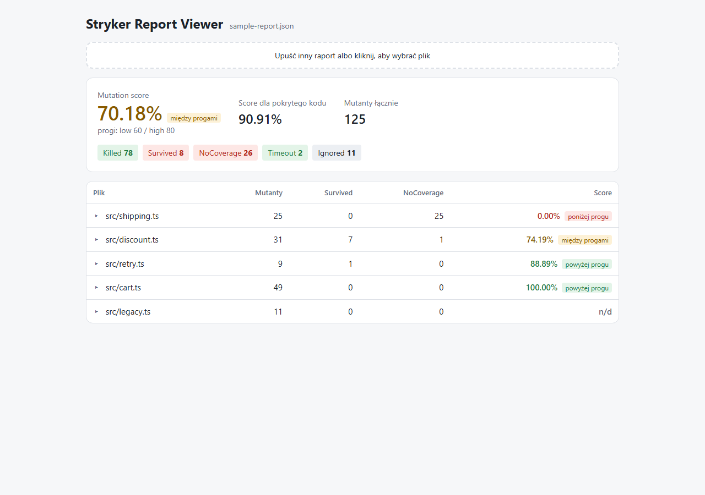
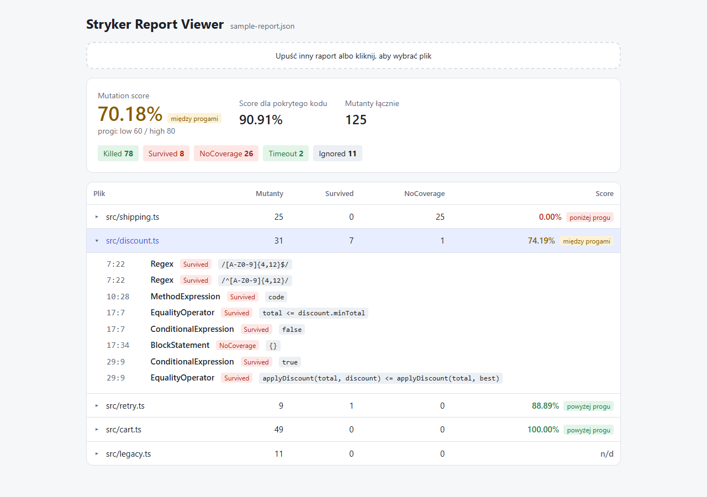
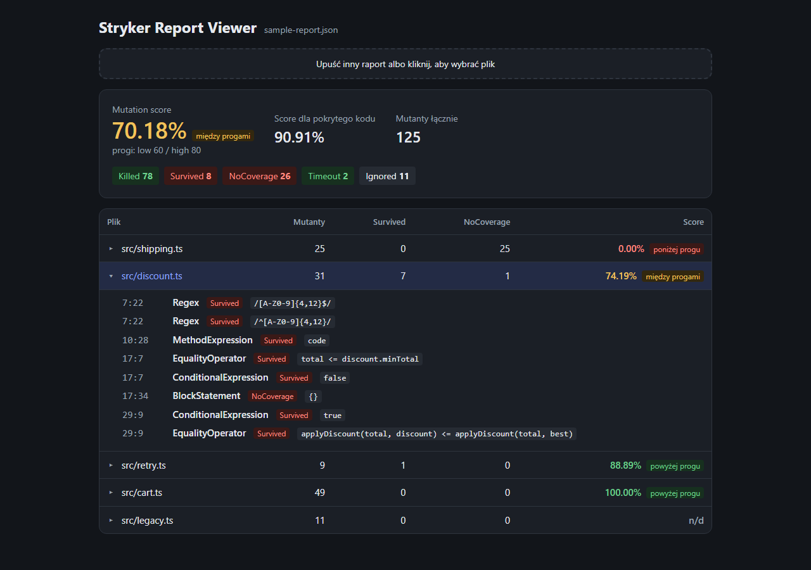
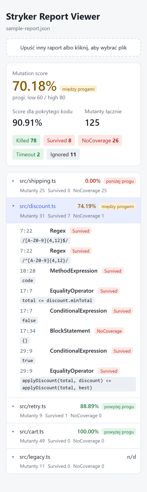

# Stryker Report Viewer

Prosta aplikacja webowa do przeglądania raportów JSON ze [Stryker Mutator](https://stryker-mutator.io/).
Wczytujesz plik raportu, a aplikacja pokazuje:

- mutation score z oceną względem progów z raportu (domyślnie low 60 / high 80),
- score dla pokrytego kodu i liczniki mutantów według statusu,
- tabelę plików od najniższego wyniku,
- po rozwinięciu pliku: listę mutantów, które przeżyły (`Survived`, `NoCoverage`).

Plik jest analizowany wyłącznie w przeglądarce i nie jest nigdzie wysyłany.

## Zrzuty ekranu

Podsumowanie raportu i tabela plików:



Rozwinięty plik z listą mutantów, które przeżyły:



| Tryb ciemny | Telefon |
|---|---|
|  |  |

Zrzuty pokazują [przykładowy raport](#przykładowy-raport) z `examples/sample-report.json`.

## Uruchomienie

```bash
npm install
npm run dev
```

Otwórz adres wypisany przez Vite (domyślnie http://localhost:5173) i upuść plik raportu na stronę.
Na start możesz użyć przykładowego raportu `examples/sample-report.json`.

## Skąd wziąć raport JSON

Włącz reporter `json` w konfiguracji Strykera, np. w `stryker.config.json`:

```json
{
  "reporters": ["html", "clear-text", "progress", "json"]
}
```

Po uruchomieniu `npx stryker run` raport znajdziesz w `reports/mutation/mutation.json`.

## Przykładowy raport

`examples/sample-report.json` to prawdziwy raport StrykerJS wygenerowany na małym projekcie
`examples/sample-project/` (koszyk w sklepie). Testy są w nim celowo zróżnicowane, żeby w raporcie
pojawiły się różne statusy mutantów i pliki o różnych wynikach. Z raportu usunięto pola
`projectRoot` i `system`, które opisują maszynę, na której go wygenerowano.

Aby wygenerować raport ponownie:

```bash
cd examples/sample-project
npm install
npm run mutation
```

Liczby mogą się nieznacznie różnić między wersjami Strykera.

> Projekt przykładowy używa Vitest 4, bo `@stryker-mutator/vitest-runner` 10 nie działa jeszcze
> z Vitest 5: nie zgłasza błędu, ale nie aktywuje mutantów, więc prawie wszystkie wychodzą jako `Survived`.

## Skrypty

| Polecenie | Opis |
|---|---|
| `npm run dev` | serwer deweloperski |
| `npm run build` | build produkcyjny do `dist/` |
| `npm run preview` | podgląd buildu produkcyjnego |
| `npm test` | testy jednostkowe (Vitest) |
| `npm run typecheck` | sprawdzenie typów (`tsc --noEmit`) |
| `npm run screenshots` | buduje aplikację i zapisuje zrzuty ekranu do `docs/screenshots/` (Playwright) |

Przed pierwszym `npm run screenshots` zainstaluj przeglądarkę dla Playwright:

```bash
npx playwright install chromium
```
